# AcessaCidade — Mapa Colaborativo de Acessibilidade Urbana

> **Global Solution FIAP · 2º semestre de 2026 · Flutter / Dart**

## Equipe

**FIAP — Sistemas de Informação — Global Solution 2026.2**

| Integrante | RM |
| --- | --- |
| Enzo Grisolia de Souza | 555706 |
| Lucas Rodrigues Alves | 555377 |
| Rafael Catapani Scharlack | 554633 |

O **AcessaCidade** é um protótipo acadêmico de aplicativo colaborativo para registrar, consultar e acompanhar barreiras de acessibilidade em espaços urbanos. A proposta é reunir relatos da comunidade e informações sobre equipamentos públicos em uma interface que ajude cidadãos a identificar problemas e gestores a priorizar melhorias.

**Área demonstrativa:** Bela Vista, São Paulo (SP).

> [!IMPORTANT]
> **Protótipo acadêmico.** As localizações representadas no mapa-base são reais, mas os estabelecimentos de referência, relatos e notícias apresentados como dados iniciais são **fictícios/demonstrativos**. O aplicativo **não deve ser utilizado para tomar decisões reais de deslocamento**. A pré-análise identificada como “IA” é uma simulação; não existe análise automática real das fotos.

## 1. Problema e proposta

Calçadas danificadas, rampas inadequadas, ausência de piso tátil e outras barreiras podem dificultar a circulação de pessoas com deficiência, idosos e pessoas com mobilidade reduzida. Muitas dessas ocorrências não estão reunidas em uma fonte única e acessível para consulta e acompanhamento.

O AcessaCidade propõe um **mapa colaborativo de barreiras urbanas** no qual os usuários podem explorar pontos, filtrar ocorrências conforme suas necessidades, criar relatos com fotografias e participar da validação comunitária. Um painel demonstrativo permite que gestores acompanhem ocorrências, aprovem publicações e consultem uma ordenação de prioridades.

### Público-alvo

- Pessoas usuárias de cadeira de rodas e pessoas com mobilidade reduzida;
- Pessoas com deficiência visual;
- Pessoas idosas e acompanhantes;
- Pessoas que utilizam carrinhos de bebê;
- Gestores públicos e organizações interessadas em acessibilidade urbana.

## 2. Funcionalidades

| Área | Recursos implementados |
| --- | --- |
| **Splash e onboarding** | Identidade visual, transição automática, introdução em três páginas e preferência “Não mostrar novamente” com `SharedPreferences`. |
| **Mapa** | Mapa interativo, marcadores de serviços e barreiras, filtros por perfil e categoria, detalhes e visualização alternativa em lista. |
| **Locais** | 31 locais de referência fictícios, pesquisa, filtros por tipo de serviço, fichas de acessibilidade com respostas **Sim/Não** e barreiras próximas. |
| **Relatar** | Cadastro de ocorrência com título, categoria, descrição, perfis afetados, localização no mapa, endereço, fotografia e texto alternativo. |
| **Consulta REST** | Geocodificação reversa de coordenadas pela API Nominatim/OpenStreetMap, com estados inicial, carregando, sucesso e erro e opção de nova tentativa. |
| **Comunidade** | Confirmação de que uma barreira ainda existe ou indicação de resolução; status e contagens atualizados localmente. |
| **Moderação** | Novos relatos entram em uma fila de validação e só se tornam públicos após aprovação; possibilidade de rejeição. |
| **Notícias** | Conteúdo fictício de caráter informativo e um destaque principal. |
| **Gestor** | Indicadores, insights demonstrativos, ordenação de prioridades, fila de moderação e exportação de relatório em PDF. |
| **Responsividade** | Navegação adaptada a desktop e dispositivos móveis. |

### Dados de demonstração

A versão V8 inicia com **31 locais de referência** e **10 relatos fictícios**, além de notícias demonstrativas. Os relatos criados no aplicativo são armazenados localmente no dispositivo/navegador utilizado.

## 3. Tecnologias

- **Flutter e Dart:** desenvolvimento de interface e navegação multiplataforma;
- **`flutter_map` e `latlong2`:** exibição de mapas, marcadores e coordenadas;
- **OpenStreetMap:** cartografia de fundo;
- **`http`:** requisição HTTP para a API REST de endereços;
- **Nominatim:** consulta reversa de endereço mediante ação do usuário;
- **`shared_preferences`:** armazenamento local das preferências e dos relatos;
- **`image_picker`:** seleção de fotografia;
- **`pdf` e `printing`:** geração e compartilhamento/exportação de relatório PDF;
- **`flutter_test`:** testes automatizados.

As versões exatas/intervalos das dependências estão definidos em [`pubspec.yaml`](pubspec.yaml).

## 4. Arquitetura do projeto

A aplicação separa interface, modelos, componentes reutilizáveis e regras de negócio:

```text
AcessaCidade_Flutter_V8/
├── assets/
│   └── images/                 # Logotipo do aplicativo
├── lib/
│   ├── core/                   # Tema e dados demonstrativos
│   ├── models/                 # Modelos de relato, local, notícia e endereço
│   ├── screens/                # Splash, onboarding, mapa, locais, relato, notícias e gestor
│   ├── services/               # Estado, preferências, REST, prioridades e PDF
│   ├── widgets/                # Componentes compartilhados
│   └── main.dart               # Ponto de entrada
├── test/                        # Testes unitários e de widget
├── docs/                        # Fluxo de demonstração e matriz de requisitos
├── pubspec.yaml
└── README.md
```

A interface utiliza `StatelessWidget`, `StatefulWidget`, `setState`, componentes reutilizáveis e um `AppState` baseado em `ChangeNotifier` para compartilhar atualizações entre as telas.

### Fluxo de publicação

```text
Cidadão registra ocorrência
            ↓
    Relato pendente
            ↓
     Fila do gestor
       ↙       ↘
   Aprovar     Rejeitar
      ↓           ↓
Mapa público  Não publicado
```

A moderação é **local e demonstrativa**, sem autenticação robusta, servidor próprio ou controle de permissões de produção.

## 5. API REST e estados de requisição

O arquivo `lib/services/geocoding_service.dart` realiza uma consulta **GET** ao endpoint de geocodificação reversa da API pública Nominatim:

```text
https://nominatim.openstreetmap.org/reverse
```

A requisição envia latitude, longitude, idioma (`pt-BR`) e formato de resposta JSON. O retorno é convertido para o modelo `GeocodedAddress`.

Na tela **Relatar**, a consulta possui quatro estados explícitos:

1. **Inicial:** consulta ainda não solicitada;
2. **Carregando:** aguardando resposta;
3. **Sucesso:** endereço recuperado e apresentado;
4. **Erro:** mensagem ao usuário e opção de tentar novamente.

O campo de endereço também aceita preenchimento manual. **A consulta exige conexão com a internet** e está sujeita às políticas e à disponibilidade da API pública. O serviço foi pensado para acionamento manual, não para autocomplete.


### Fluxo de telas

O AcessaCidade possui um fluxo de navegação responsivo, desenvolvido em Flutter, que permite ao cidadão consultar locais públicos, identificar barreiras de acessibilidade e registrar novas ocorrências.

```text
Splash Screen
     |
     v
Onboarding (3 telas — exibido no primeiro acesso)
     |
     v
Tela principal — AcessaCidade
     |
     +-- Mapa: marcadores, filtros e detalhes das barreiras
     +-- Locais: pesquisa, categorias e checklist Sim/Não
     +-- Relatar: cadastro de barreiras, localização e fotografia
     +-- Notícias: informações demonstrativas sobre acessibilidade
     +-- Gestor: indicadores, moderação, prioridades e relatório PDF
```

**Fluxo de registro e moderação:**

1. O cidadão acessa **Relatar**, informa os dados da barreira e seleciona sua localização.
2. O relato é enviado para uma **fila de moderação**, sem publicação imediata no mapa.
3. O gestor consulta a ocorrência e a pré-análise demonstrativa de IA.
4. Se o relato for **aprovado**, ele passa a aparecer no mapa e na lista pública. Se for **rejeitado**, permanece fora da visualização pública.
5. A comunidade pode consultar os detalhes e informar se a barreira ainda existe ou foi resolvida.

O sistema também permite navegar pelos locais públicos, consultar checklists de acessibilidade e visualizar indicadores no painel do gestor.

Para mais informações, consulte [Fluxo e demonstração](docs/fluxo_e_demo.md).

### Prints das telas

Capturas reais da aplicação em execução (build Web de produção, `flutter build web --release`, em viewport de celular 412 px). Todos os arquivos estão na pasta [`prints/`](prints/).

#### Splash e Onboarding

| Splash | Onboarding 1 | Onboarding 2 | Onboarding 3 |
| :---: | :---: | :---: | :---: |
| 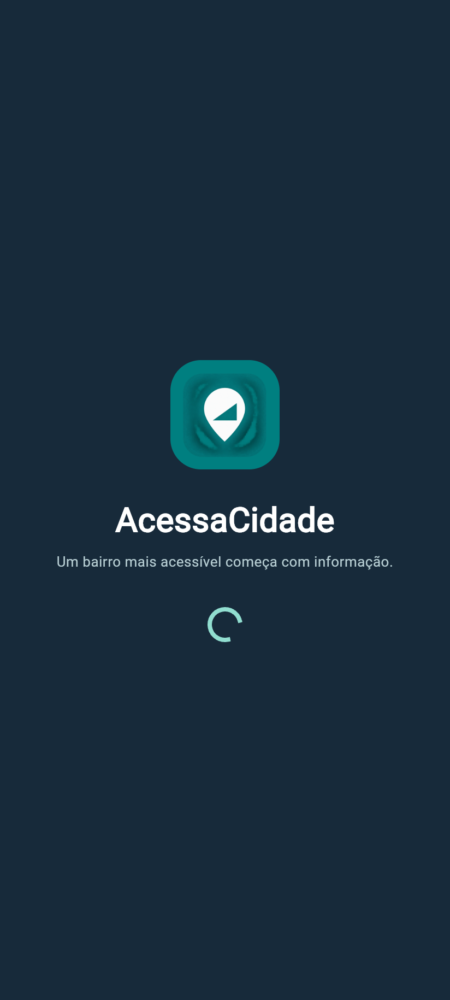 | 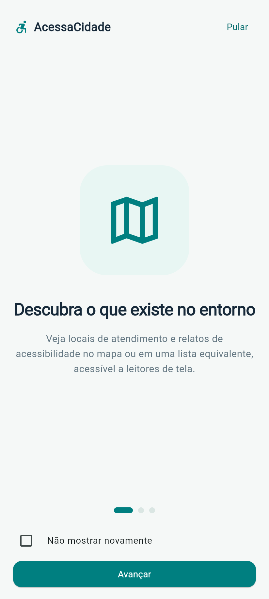 | 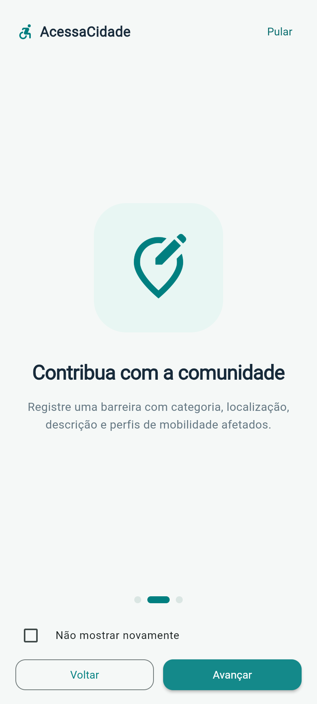 | 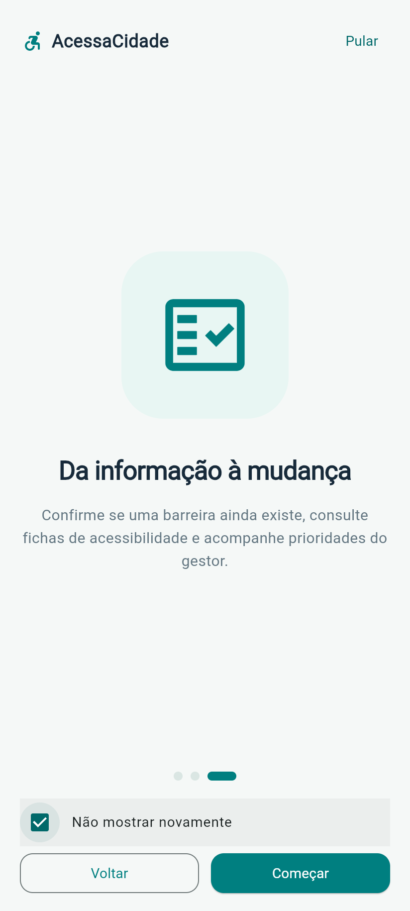 |
| [01-splash.png](prints/01-splash.png) | [02-onboarding-1.png](prints/02-onboarding-1.png) | [03-onboarding-2.png](prints/03-onboarding-2.png) | [04-onboarding-3-nao-mostrar-novamente.png](prints/04-onboarding-3-nao-mostrar-novamente.png) |

#### Mapa

| Mapa | Lista equivalente | Detalhe de local | Detalhe de barreira |
| :---: | :---: | :---: | :---: |
| 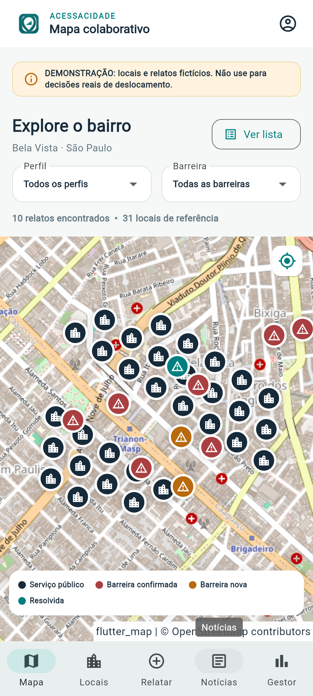 | 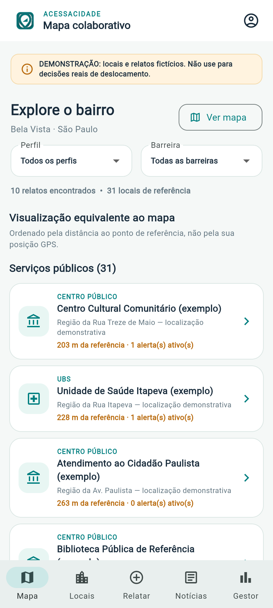 | 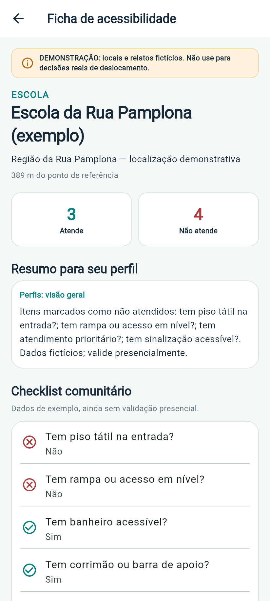 | 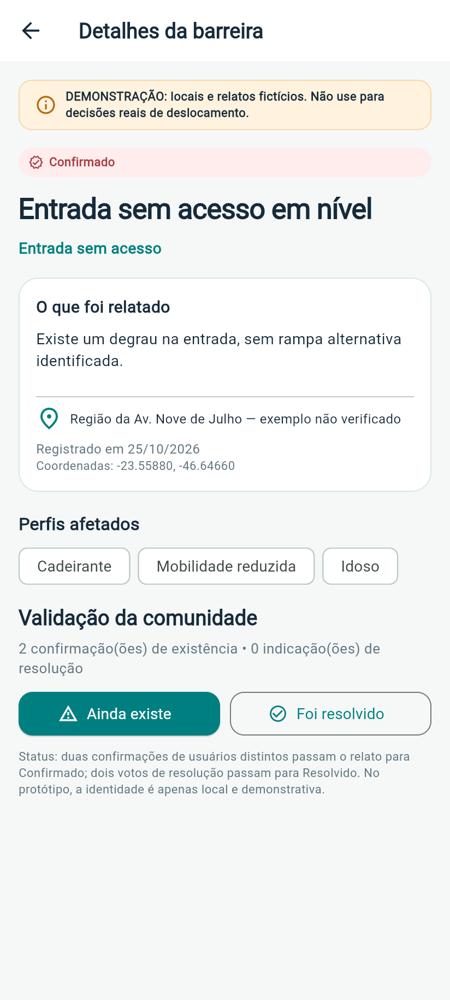 |
| [05-mapa.png](prints/05-mapa.png) | [06-mapa-lista.png](prints/06-mapa-lista.png) | [07-detalhe-local.png](prints/07-detalhe-local.png) | [08-detalhe-barreira.png](prints/08-detalhe-barreira.png) |

#### Locais

| Lista de locais | Filtro por tipo (UBS) | Busca sem resultado |
| :---: | :---: | :---: |
| 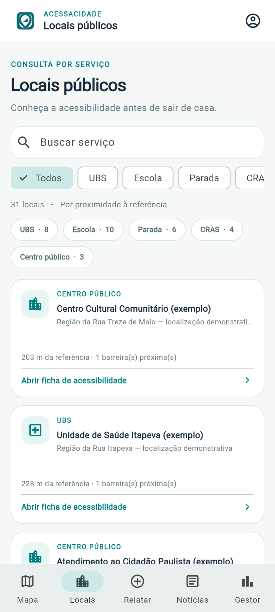 | 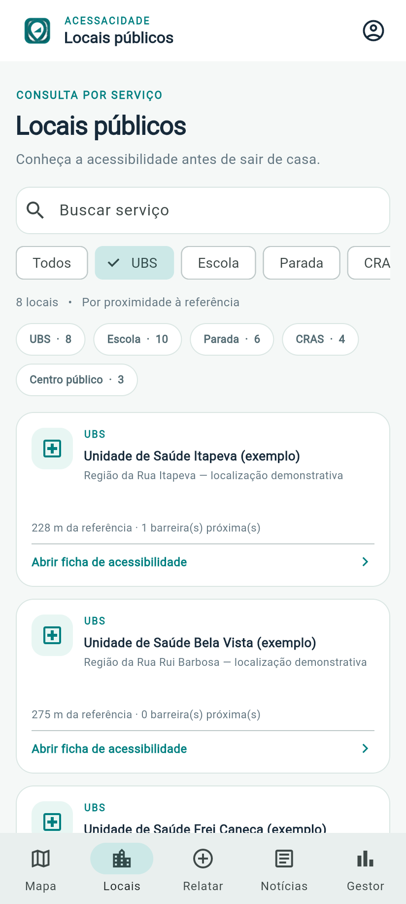 | 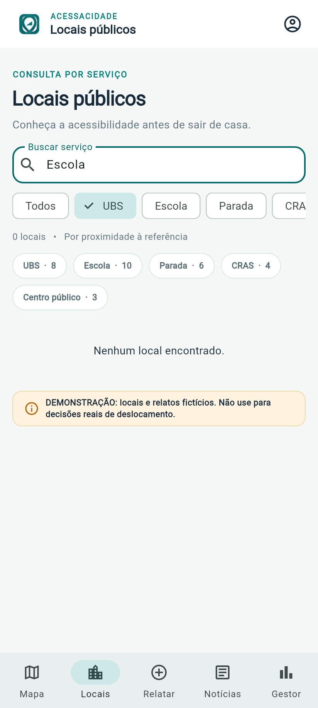 |
| [09-locais.png](prints/09-locais.png) | [10-locais-filtro.png](prints/10-locais-filtro.png) | [11-locais-busca.png](prints/11-locais-busca.png) |

#### Relatar — estados da API REST (Nominatim)

| Inicial | Carregando | Sucesso | Erro + tentar novamente |
| :---: | :---: | :---: | :---: |
| 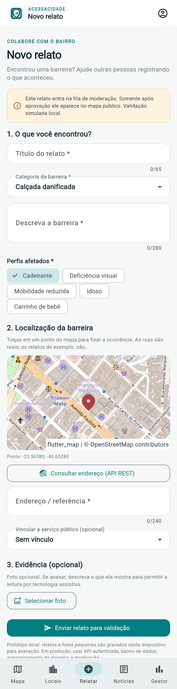 | 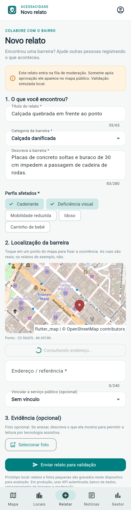 | 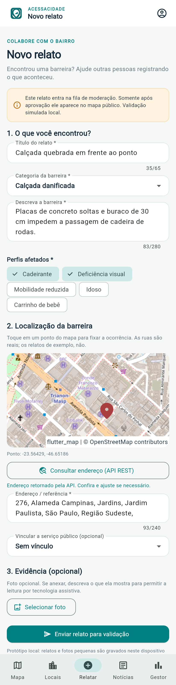 | 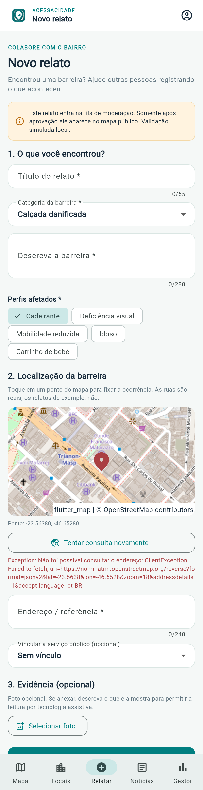 |
| [12-relatar-api-inicial.png](prints/12-relatar-api-inicial.png) | [13-relatar-api-carregando.png](prints/13-relatar-api-carregando.png) | [14-relatar-api-sucesso.png](prints/14-relatar-api-sucesso.png) | [15-relatar-api-erro.png](prints/15-relatar-api-erro.png) |

> O estado de **erro** foi capturado simulando a falta de conexão com a API durante a requisição.

#### Envio do relato e moderação

| Perfil local | Relato enviado (pendente) | Fila de moderação | Relato aprovado | Mapa após aprovação |
| :---: | :---: | :---: | :---: | :---: |
| 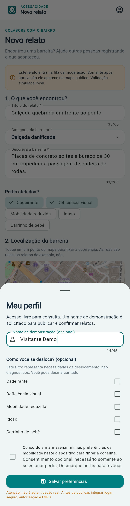 | 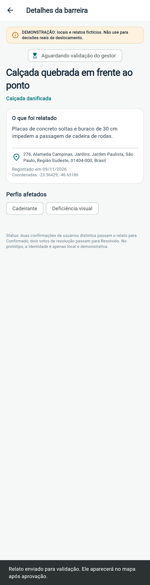 | 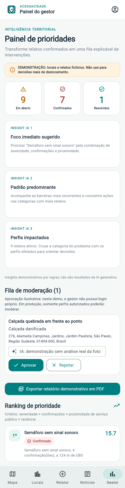 | 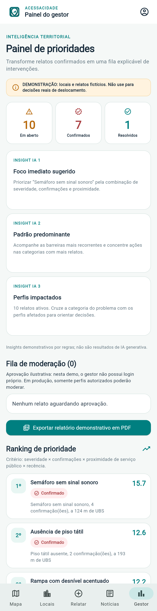 | 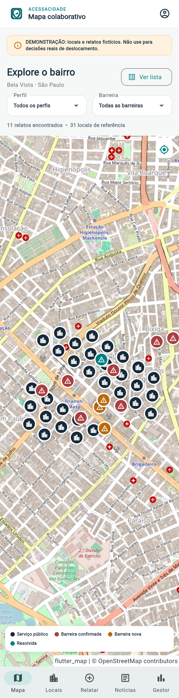 |
| [16-perfil.png](prints/16-perfil.png) | [17-relato-enviado.png](prints/17-relato-enviado.png) | [20-gestor-fila-moderacao.png](prints/20-gestor-fila-moderacao.png) | [21-gestor-relato-aprovado.png](prints/21-gestor-relato-aprovado.png) | [23-mapa-apos-aprovacao.png](prints/23-mapa-apos-aprovacao.png) |

#### Notícias e Gestor

| Notícias | Painel do gestor | Ranking de prioridade |
| :---: | :---: | :---: |
| 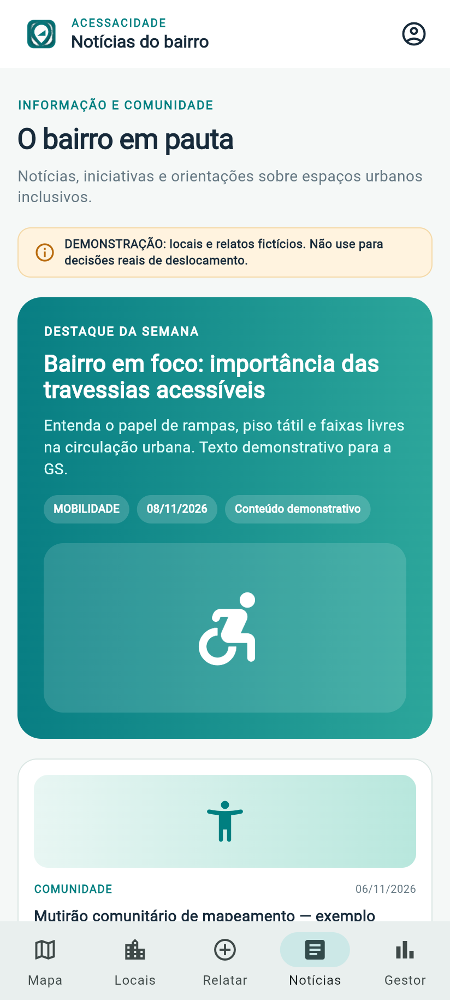 | 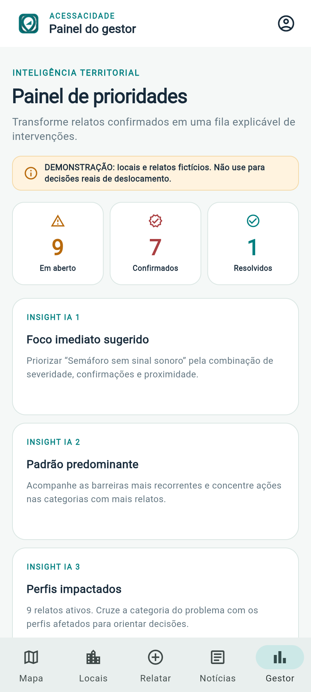 | 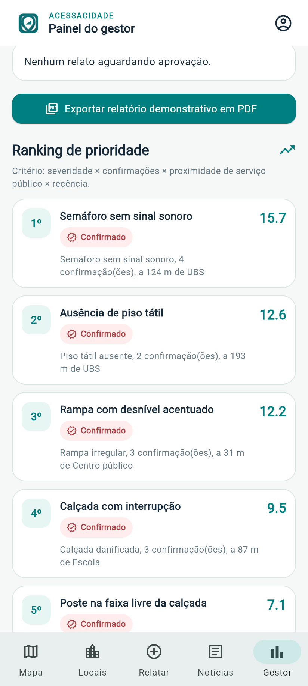 |
| [18-noticias.png](prints/18-noticias.png) | [19-gestor.png](prints/19-gestor.png) | [22-gestor-ranking.png](prints/22-gestor-ranking.png) |
  

## 6. Priorização das ocorrências

O painel do gestor usa uma **pontuação demonstrativa e explicável** implementada em `lib/services/priority_service.dart`:

\[
P = S \times (1 + \ln(1+C)) \times (1+E) \times R
\]

Em que:

- **S:** gravidade definida pela categoria da barreira;
- **C:** quantidade de confirmações da comunidade;
- **E:** fator de proximidade de equipamentos públicos (até 200 m);
- **R:** fator de recência do relato.

Relatos marcados como **resolvidos** recebem pontuação zero. Essa fórmula é uma **heurística acadêmica**, não uma metodologia oficial da prefeitura.

## 7. Como executar

### Pré-requisitos

- Flutter SDK instalado e configurado;
- Dart SDK disponibilizado pelo Flutter;
- Google Chrome para a execução Web;
- Android SDK e emulador/dispositivo, caso deseje executar no Android;
- Acesso à internet para carregamento dos mapas e consulta Nominatim.

### Primeira execução

Abra o terminal na **raiz do projeto**, onde está o `pubspec.yaml`:

```powershell
# Apenas se o projeto extraído ainda não contiver as pastas android/ e web/:
flutter create --project-name acessacidade --platforms=android,web .

flutter pub get
flutter run -d chrome --web-port=8080
```

O endereço Web será `http://localhost:8080`.

> **Dica:** no Flutter Web, o `SharedPreferences` fica associado à origem (incluindo a porta). Utilize sempre a mesma porta para testar a opção “Não mostrar novamente” do onboarding. Em janela anônima, as preferências podem ser descartadas quando a sessão é encerrada.

### Verificações e build

```powershell
flutter analyze
flutter test
flutter build web --release
```

Quando o build terminar, os arquivos da versão Web estarão em `build/web/`.

## 8. Testes realizados

A equipe executou as seguintes validações locais na **V8**:

| Validação | Resultado informado |
| --- | --- |
| Análise estática (`flutter analyze`) | **No issues found!** |
| Testes automatizados (`flutter test`) | **6 testes aprovados** |
| Compilação Web de produção (`flutter build web --release`) | **Concluída** |
| Execução em Chrome | **Funcionando** |
| Testes manuais de Mapa | **8/8 aprovados** |
| Testes manuais de Locais | **7/7 aprovados** |
| Testes manuais de Relatar e Moderação | **12/12 aprovados** |
| Testes manuais de Notícias e Gestor | **11/11 aprovados** |
| Testes manuais de Estabilidade | **10/10 aprovados** |

**Total de testes manuais informados: 48/48 aprovados.** Os testes foram executados e reportados pelo grupo em ambiente local; a tabela não substitui uma auditoria externa de acessibilidade ou de segurança.

Os testes automatizados verificam, entre outros comportamentos, visibilidade de relatos pendentes, ranking e pontuação de prioridade, confirmações comunitárias e representação textual do status.

## 9. Limitações do protótipo

- O sistema é uma **demonstração acadêmica**, com dados iniciais fictícios e foco no bairro Bela Vista.
- Não existe backend próprio, banco de dados centralizado ou sincronização entre usuários/dispositivos.
- O armazenamento de relatos, imagens e preferências é **local**, sujeito aos limites do navegador/dispositivo.
- O perfil local não equivale a um sistema real de autenticação; o painel de gestor não possui controle seguro de acesso.
- A “IA” apresentada no fluxo de moderação e os insights são **demonstrativos**; não há modelo treinado analisando fotografias.
- Os mapas e endereços dependem de serviços públicos externos, cujos **termos de uso, limites e atribuição** devem ser respeitados antes de qualquer disponibilização em escala.
- O aplicativo ainda não foi auditado segundo critérios WCAG nem validado em estudos com usuários com deficiência.
- As informações exibidas **não são adequadas para planejar deslocamentos reais**.

## 10. Links e materiais da entrega

- **Vídeo de demonstração/pitch:** `[ADICIONAR LINK, SE EXIGIDO]`
- **Capturas de tela:** pasta [`prints/`](prints/) — veja a seção [Prints das telas](#prints-das-telas).

---

**AcessaCidade — Um bairro mais acessível começa com informação.**
